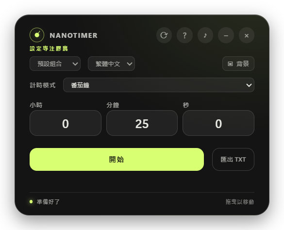
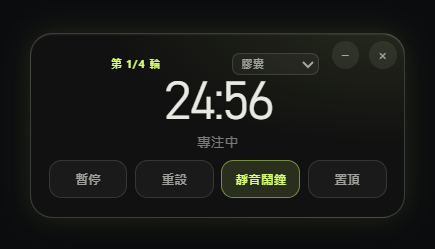
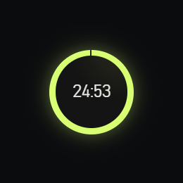
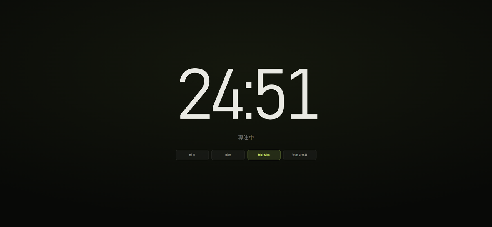

# nanotimer

A frameless, transparent countdown / stopwatch that floats on your desktop. Built with Electron — no UI framework, no build step for the renderer.

**English** · [繁體中文](#繁體中文) · [简体中文](#简体中文) · [日本語](#日本語)

| Setup | Capsule panel |
| --- | --- |
|  |  |
| **Mini** | **Fullscreen** |
|  |  |

---

## English

### Features

- **Countdown, stopwatch and Pomodoro** — Pomodoro runs 25 min focus / 5 min short break / 15 min long break, four rounds, and advances on its own.
- **Four display modes** — setup card, capsule pill, mini circle, fullscreen focus stage.
- **A background photo that follows every mode** — painted inside the card, the pill, the mini circle and the fullscreen stage, always behind a contrast scrim.
- **Custom completion sound**, mute toggle, alarm that loops until stopped.
- **Focus notes + TXT export** — sessions are logged locally and exported as escaped TSV with local timestamps.
- **Daily stats and streak** — the setup footer shows today's completed rounds, their minutes, and consecutive days.
- **Global shortcuts and a tray icon** — `Ctrl+Alt+Space` pauses from anywhere, `Ctrl+Alt+R` resets; the tray keeps the app reachable.
- **+5 minutes without leaving the timer** — click the time when a countdown finishes.
- **Smooth mode changes** — fade out, resize the native window, fade in, so no frame is stretched or clipped.
- **Dragging that matches what you see** — the pill and the ring are the drag surface; the transparent area around them does nothing.
- **Built-in help and update check** — `?` explains the app in your language, `⟳` checks GitHub releases and installs the new build in place, keeping every setting.
- **Named presets** — save the current duration under your own name ("Deep work 30"), rename or delete it later; nothing is preinstalled.
- **Edge snapping, always-on-top, four UI languages** (English, 繁體中文, 简体中文, 日本語).

### Display modes

| Mode | Looks like | Reached by |
| --- | --- | --- |
| Setup | 420×330 card with the form | default, or *New timer* |
| Capsule | small pill that expands on hover into the control panel | *Start* |
| Mini | 96 px progress circle, click to return to capsule | mode select, or `M` |
| Fullscreen | edge-to-edge focus stage | mode select, or `F` |

### Keyboard shortcuts

| Key | Action |
| --- | --- |
| `Space` | Pause / resume |
| `R` or `Esc` | Reset (press twice; the first press shows a confirmation) |
| `F` | Toggle fullscreen |
| `M` | Toggle mini mode |
| `Shift` + `M` | Mute / unmute |
| `Ctrl` + `Alt` + `Space` | Pause / resume from any app |
| `Ctrl` + `Alt` + `R` | Reset from any app |

### Install

Download one of the two Windows x64 builds from the releases page:

| File | What it is |
| --- | --- |
| `nanotimer-1.0.2-setup.exe` | Installer — Start-menu shortcut, optional install directory, uninstall keeps your data |
| `nanotimer-1.0.2-portable.exe` | Single file — run it from a USB stick, nothing is installed |

Both builds share one profile, so switching between them never loses your background image, presets or history. The binaries are unsigned, so SmartScreen shows *Windows protected your PC* on first run: choose **More info → Run anyway**.

### Where your data lives

Settings live in `%APPDATA%\nanotimer` (installer and portable alike). Create a `portable.txt` next to the executable to keep the profile in a `nanotimer` folder beside it instead. Upgrading or reinstalling never touches this directory.

```
nanotimer/
├─ alerts/        # imported completion sounds (token + extension)
├─ backgrounds/   # imported background images (token + extension)
└─ updates/       # downloaded installers, kept for re-install
```

Preferences — language, presets, last configuration, logs, timer mode, mute, background token — live in `localStorage` under `nanotimer.*`. Completed rounds are stored in `nanotimer.stats` as `{ "YYYY-MM-DD": { sessions, seconds } }`, which is also what the streak is computed from.

### Build from source

```bash
npm install
npm start          # run from source
npm run check      # syntax-check every JavaScript file
npm test           # unit tests
npm run dist       # both Windows builds into dist/
```

`npm run dist` produces `dist/nanotimer-1.0.2-setup.exe` and `dist/nanotimer-1.0.2-portable.exe`. The icon is `build/icon.ico` (16–256 px). Requirements: Node.js 20 or newer.

### Project structure

```
src/
├─ main/
│  ├─ main.js        # windows, IPC, display modes, tray, updater, imports
│  ├─ preload.js     # frozen contextBridge surface
│  └─ window-snap.js # pure edge-snapping helper (unit tested)
├─ renderer/
│  ├─ index.html
│  ├─ renderer.js    # UI state, timers, i18n, export, background, help
│  └─ styles.css
├─ launcher/         # optional C# launcher (sandbox-safe start)
build/               # icon.ico / icon.png
docs/shots/          # screenshots used above
scripts/             # start helper, launcher build, Windows diagnostics
test/                # node --test
```

**Security posture:** `contextIsolation: true`, `nodeIntegration: false`, `sandbox: true`, a restrictive CSP, denied `window.open` and navigation. Imported files are copied into the profile and addressed by an opaque token. The updater only downloads over HTTPS from `github.com` / `githubusercontent.com` and only runs an `.exe` inside its own `updates` folder.

### Troubleshooting

**The packaged exe exits immediately (`0x80000003`).** Electron 45 aborts on Windows 11 build 26200+; `scripts/start.js` sets `ELECTRON_DISABLE_SANDBOX=1` there, and the launcher retries with `--no-sandbox`.

**SmartScreen blocks the first run.** Unsigned binaries — *More info → Run anyway*, or sign your build.

**Updates say "Could not check for updates".** The repository has no published release yet, or GitHub is unreachable.

### License

[MIT](LICENSE) © 2026 Alan

---

## 繁體中文

### 功能

- **倒數、碼錶、番茄鐘** — 番茄鐘為 25 分鐘專注 / 5 分鐘短休 / 15 分鐘長休，共四輪，時間到會自動接續。
- **四種顯示模式** — 設定卡、膠囊、迷你圓環、全螢幕專注畫面。
- **背景圖片跟著每一種模式** — 卡片、膠囊、迷你圓環與全螢幕都會顯示，並加上對比遮罩讓文字保持清晰。
- **自訂完成音效**、靜音切換、鬧鐘會持續響到停止。
- **專注筆記與 TXT 匯出** — 每次計時都記錄在本機，可匯出帶時間戳的 TSV。
- **每日統計與連續天數** — 設定頁底部顯示今天完成的輪數、分鐘數與連續使用天數。
- **全域快捷鍵與系統匣圖示** — `Ctrl+Alt+Space` 在任何程式都能暫停，`Ctrl+Alt+R` 重設。
- **倒數結束後點一下時間即可加 5 分鐘**。
- **模式切換有過渡動畫** — 先淡出、再縮放視窗、最後淡入，不會出現拉伸或裁切。
- **拖曳範圍與看到的一致** — 只有膠囊藥丸與迷你圓環可以拖動，周圍透明區域不會誤移視窗。
- **內建說明與更新檢查** — `?` 用你的語言說明操作，`⟳` 檢查 GitHub 新版本並直接安裝，設定完整保留。
- **具名設定檔** — 把目前時間存成自己的名字（例如「專心 30 分鐘」），可改名、可刪除；預設不附任何設定檔。
- **邊緣吸附、置頂、四種介面語言**（English、繁體中文、简体中文、日本語）。

### 快速鍵

| 按鍵 | 動作 |
| --- | --- |
| `Space` | 暫停／繼續 |
| `R` 或 `Esc` | 重設（按兩次，第一次會顯示確認提示） |
| `F` | 切換全螢幕 |
| `M` | 切換迷你模式 |
| `Shift` + `M` | 靜音／取消靜音 |
| `Ctrl` + `Alt` + `Space` | 從任何程式暫停／繼續 |
| `Ctrl` + `Alt` + `R` | 從任何程式重設 |

### 安裝

從 Releases 下載 Windows x64 版本：

| 檔案 | 說明 |
| --- | --- |
| `nanotimer-1.0.2-setup.exe` | 安裝版：開始選單捷徑、可選安裝位置、移除時保留設定 |
| `nanotimer-1.0.2-portable.exe` | 免安裝單一檔案：可放在 USB，不寫入系統 |

兩種版本共用同一份設定，互換使用不會遺失背景圖片、預設組合或紀錄。執行檔未簽章，第一次啟動會出現 SmartScreen，請選「其他資訊 → 仍要執行」。

### 資料位置

設定放在 `%APPDATA%\nanotimer`（安裝版與免安裝版都一樣）。若在執行檔旁放一個 `portable.txt`，設定會改存在旁邊的 `nanotimer` 資料夾。更新或重新安裝都不會動到這個目錄。

```
nanotimer/
├─ alerts/        # 自訂音效
├─ backgrounds/   # 背景圖片
└─ updates/       # 已下載的安裝檔
```

語言、預設組合、上次設定、紀錄、計時模式、靜音、背景圖 token 都存在 `localStorage` 的 `nanotimer.*` 鍵；完成的輪數存在 `nanotimer.stats`。

### 從原始碼建置

```bash
npm install
npm start          # 直接執行
npm run check      # 語法檢查
npm test           # 單元測試
npm run dist       # 產生安裝版與免安裝版
```

產出為 `dist/nanotimer-1.0.2-setup.exe` 與 `dist/nanotimer-1.0.2-portable.exe`，圖示為 `build/icon.ico`。需要 Node.js 20 以上。

### 授權

[MIT](LICENSE) © 2026 Alan

---

## 简体中文

### 功能

- **倒数、秒表、番茄钟** — 番茄钟为 25 分钟专注 / 5 分钟短休 / 15 分钟长休，共四轮，自动接续。
- **四种显示模式** — 设置卡、胶囊、迷你圆环、全屏专注画面。
- **背景图片跟随每一种模式** — 卡片、胶囊、迷你圆环与全屏都会显示，并加对比遮罩保证可读。
- **自定义完成音效**、静音切换、闹钟持续响到停止。
- **专注笔记与 TXT 导出** — 每次计时记录在本机，可导出带时间戳的 TSV。
- **每日统计与连续天数** — 设置页底部显示今天完成的轮数、分钟数与连续使用天数。
- **全局快捷键与托盘图标** — `Ctrl+Alt+Space` 在任何程序都能暂停，`Ctrl+Alt+R` 重置。
- **倒数结束后点一下时间即可加 5 分钟**。
- **模式切换有过渡动画** — 先淡出、再缩放窗口、最后淡入，不会拉伸或裁切。
- **拖动范围与看到的一致** — 只有胶囊药丸与迷你圆环可以拖动，周围透明区域不会误移窗口。
- **内置说明与更新检查** — `?` 用你的语言说明操作，`⟳` 检查 GitHub 新版本并直接安装，设置完整保留。
- **具名预设** — 把当前时间存成自己的名字（例如「专心 30 分钟」），可改名、可删除；默认不附任何预设。
- **边缘吸附、置顶、四种界面语言**（English、繁體中文、简体中文、日本語）。

### 快捷键

| 按键 | 动作 |
| --- | --- |
| `Space` | 暂停／继续 |
| `R` 或 `Esc` | 重置（按两次，第一次显示确认提示） |
| `F` | 切换全屏 |
| `M` | 切换迷你模式 |
| `Shift` + `M` | 静音／取消静音 |
| `Ctrl` + `Alt` + `Space` | 从任何程序暂停／继续 |
| `Ctrl` + `Alt` + `R` | 从任何程序重置 |

### 安装

从 Releases 下载 Windows x64 版本：

| 文件 | 说明 |
| --- | --- |
| `nanotimer-1.0.2-setup.exe` | 安装版：开始菜单快捷方式、可选安装位置、卸载时保留设置 |
| `nanotimer-1.0.2-portable.exe` | 免安装单文件：可放在 U 盘，不写入系统 |

两种版本共用同一份设置，互换使用不会丢失背景图片、预设组合或记录。可执行文件未签名，第一次启动会出现 SmartScreen，请选「更多信息 → 仍要运行」。

### 数据位置

设置放在 `%APPDATA%\nanotimer`（安装版与免安装版相同）。若在可执行文件旁放一个 `portable.txt`，设置会改存在旁边的 `nanotimer` 文件夹。更新或重装都不会改动这个目录。

### 从源码构建

```bash
npm install
npm start
npm run check
npm test
npm run dist       # 生成安装版与免安装版
```

### 许可证

[MIT](LICENSE) © 2026 Alan

---

## 日本語

### 機能

- **カウントダウン・ストップウォッチ・ポモドーロ** — ポモドーロは 25 分集中 / 5 分短休憩 / 15 分長休憩の 4 ラウンドで、自動で次へ進みます。
- **4 つの表示モード** — 設定カード、カプセル、ミニリング、全画面の集中ステージ。
- **背景画像がすべてのモードに追従** — カード・カプセル・ミニリング・全画面の内側に表示し、可読性のためのスクリムを重ねます。
- **完了サウンドの差し替え**、ミュート切り替え、止めるまで鳴り続けるアラーム。
- **集中メモと TXT 書き出し** — セッションをローカルに記録し、タイムスタンプ付き TSV で書き出します。
- **今日の統計と連続日数** — 設定カード下部に今日の完了ラウンド・分数・連続日数を表示。
- **グローバルショートカットとトレイ** — `Ctrl+Alt+Space` でどこからでも一時停止、`Ctrl+Alt+R` でリセット。
- **終了後に時間をクリックで 5 分延長**。
- **モード切り替えのトランジション** — フェードアウト → ウィンドウのリサイズ → フェードイン。伸びや欠けが出ません。
- **見えている範囲だけドラッグ** — カプセルとミニリングがドラッグ面で、周囲の透明部分では動きません。
- **内蔵ヘルプと更新確認** — `?` は現在の言語で使い方を表示し、`⟳` は GitHub の新バージョンを確認してその場でインストールします（設定は保持）。
- **名前つきプリセット** — 現在の時間に自分で名前を付けて保存（例:「集中 30 分」）。名前の変更と削除ができ、初期状態では 1 件も入っていません。
- **画面端スナップ、最前面固定、4 言語**（English、繁體中文、简体中文、日本語）。

### ショートカット

| キー | 動作 |
| --- | --- |
| `Space` | 一時停止／再開 |
| `R` / `Esc` | リセット（2 回押し。1 回目は確認表示） |
| `F` | 全画面の切り替え |
| `M` | ミニモードの切り替え |
| `Shift` + `M` | ミュート／解除 |
| `Ctrl` + `Alt` + `Space` | どこからでも一時停止／再開 |
| `Ctrl` + `Alt` + `R` | どこからでもリセット |

### インストール

Releases から Windows x64 版をダウンロードします。

| ファイル | 内容 |
| --- | --- |
| `nanotimer-1.0.2-setup.exe` | インストーラー：スタートメニュー登録、インストール先の選択、アンインストール時もデータ保持 |
| `nanotimer-1.0.2-portable.exe` | 単一ファイル版：USB からも実行でき、システムに書き込みません |

どちらも同じプロファイルを使うため、切り替えても背景画像・プリセット・履歴は失われません。署名なしのため、初回起動時に SmartScreen が表示されます（**詳細情報 → 実行**）。

### データの場所

設定は `%APPDATA%\nanotimer` に保存されます（インストーラー版・ポータブル版とも同じ）。実行ファイルの隣に `portable.txt` を置くと、隣の `nanotimer` フォルダーに保存されます。更新や再インストールでこのフォルダーは変更されません。

### ソースからビルド

```bash
npm install
npm start
npm run check
npm test
npm run dist       # インストーラー版とポータブル版を生成
```

### ライセンス

[MIT](LICENSE) © 2026 Alan
